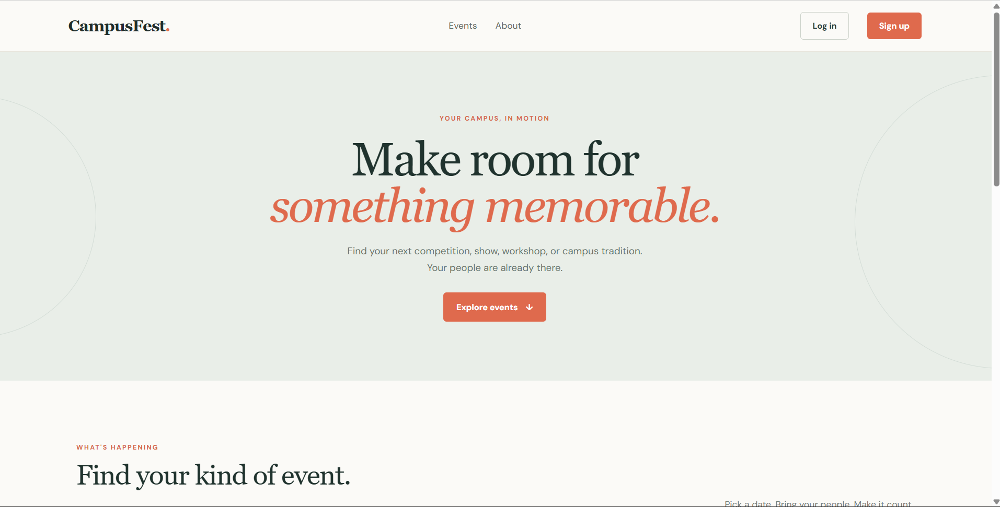
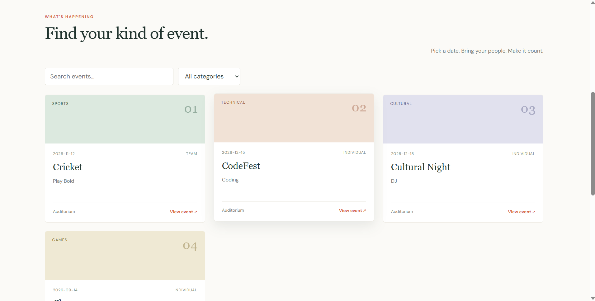
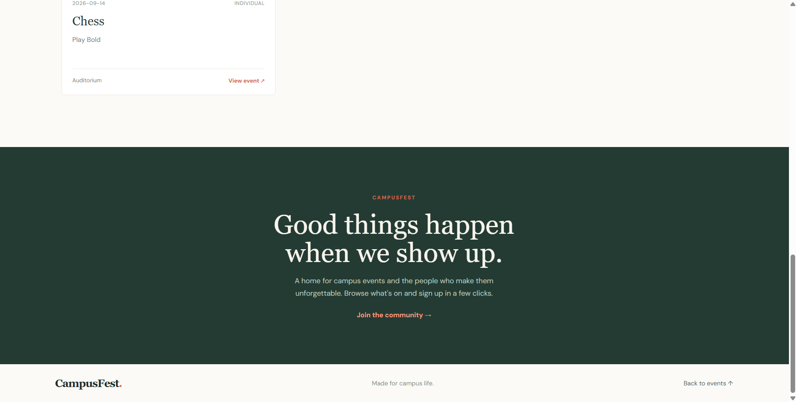

# CampusFest

CampusFest is a college event platform for discovering campus activities, registering for individual and team events, and managing sign-ups.

## Stack

- Frontend: React, Vite, React Router, Axios
- Backend: Django and Django REST Framework
- Authentication: JWT
- Database: MySQL

## Features

- Search and filter active events
- Event detail pages with individual and team registration
- Student account registration and login
- Dashboard with student profile and registration history
- Team size, membership, and captain validation

## Run locally

### Backend

1. Create and activate a virtual environment in `backend`.
2. Install dependencies with `pip install -r requirements.txt`.
3. Create `backend/.env` with `SECRET_KEY`, `DEBUG=True`, `DB_NAME`, `DB_USER`, and `DB_PASSWORD`.
4. Create the configured MySQL database, then run `python manage.py migrate`.
5. Create a Django admin user with `python manage.py createsuperuser` if needed.
6. Start Django with `python manage.py runserver`.

The API runs at `http://127.0.0.1:8000/api/`; the admin is at `http://127.0.0.1:8000/admin/`.

### Frontend

1. In `frontend`, run `npm install`.
2. Optionally create `frontend/.env` and set `VITE_API_URL=http://127.0.0.1:8000/api`.
3. Run `npm run dev` and open the Vite URL shown in the terminal.

For local development, the backend allows Vite origins at `localhost:5173` and `127.0.0.1:5173`.

## API routes

| Method | Route | Purpose |
|---|---|---|
| POST | `/api/accounts/register/` | Claim a valid student ID and create an account |
| POST | `/api/accounts/login/` | Log in and receive JWTs |
| GET | `/api/accounts/profile/` | Get the signed-in student's profile |
| GET | `/api/accounts/my-registrations/` | Get individual and team registration history |
| POST | `/api/accounts/token/refresh/` | Refresh an access token |
| GET | `/api/events/` | List active events; accepts `search` and `category` |
| GET | `/api/events/<id>/` | Get event details |
| POST | `/api/events/register/individual/` | Register for an individual event |
| POST | `/api/events/register/team/` | Register a team |

Student records must be added by an administrator before students can claim their IDs and sign up.

## Screenshots

### Homepage

### Events

### Footer
